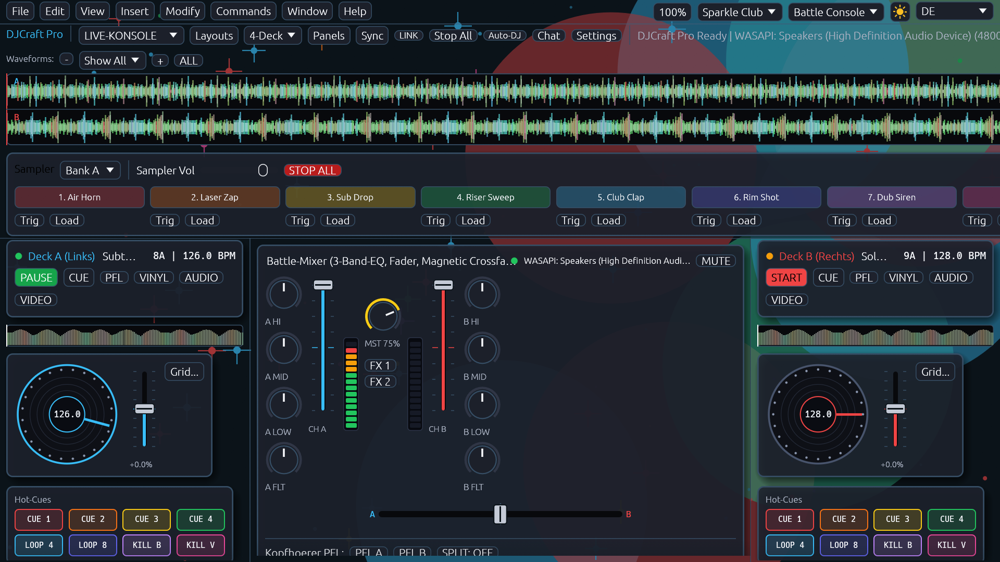
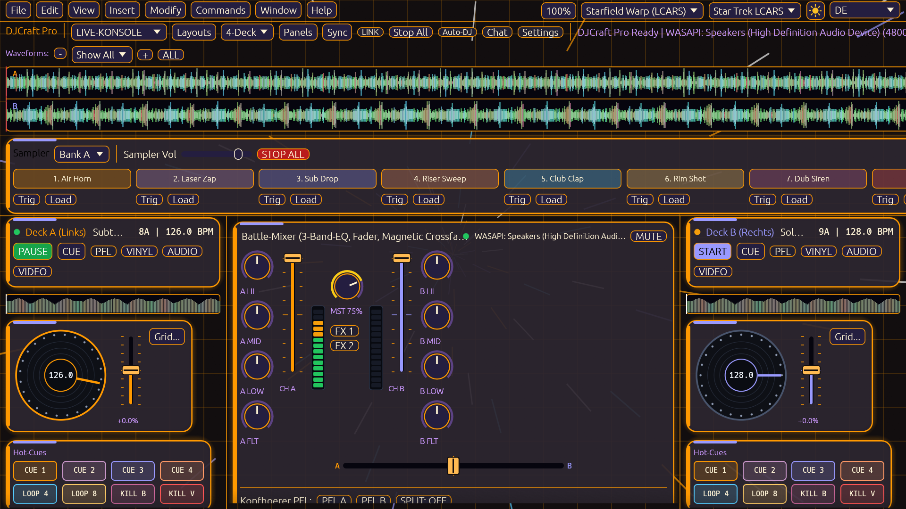
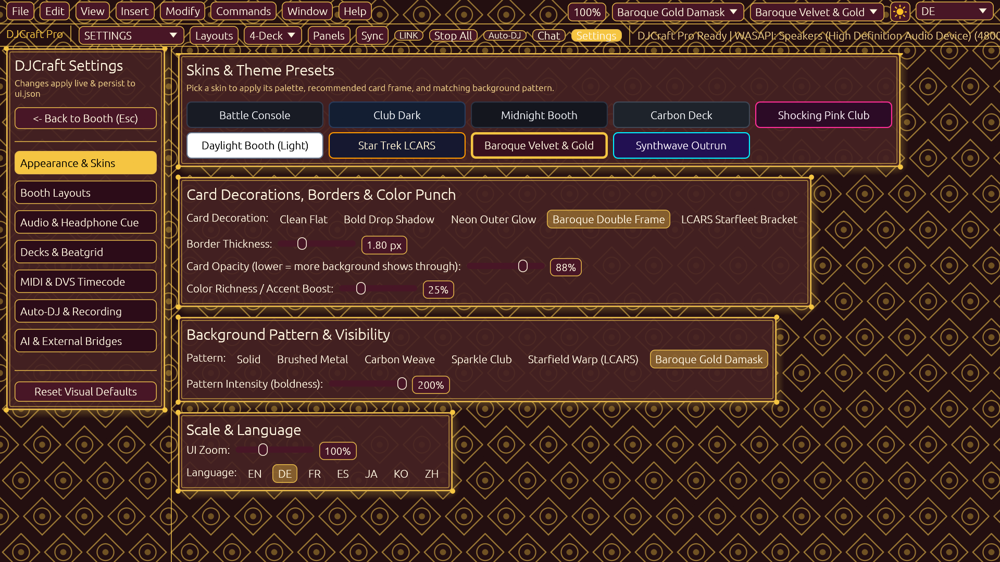
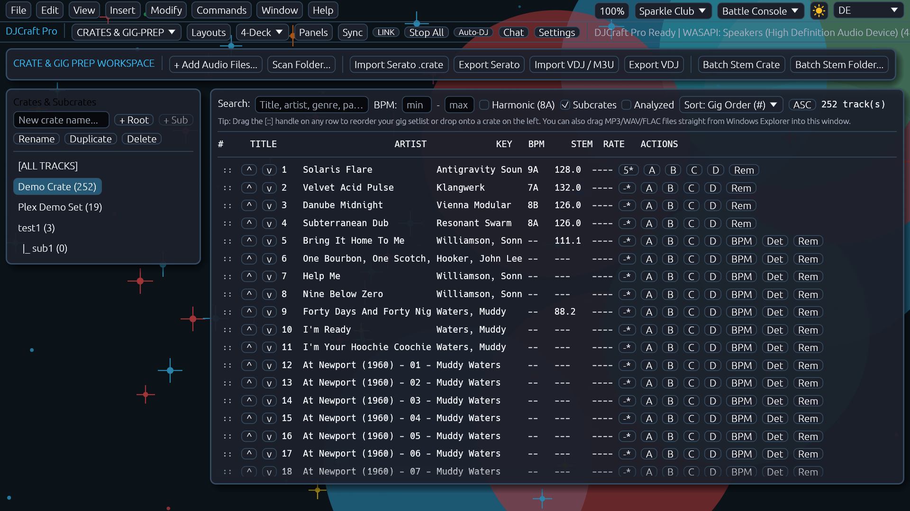

# DJCraft


**DJCraft Pro** is a local-first, 100% Safe Rust (`#![forbid(unsafe_code)]`) 4-deck audio + video DJ workstation, vinyl scratch engine, 4-stem mixer, MIDI controller host, and Camelot harmonic performance studio. GUI (`djcraft.exe`), CLI (`djcraft-cli.exe`), and MCP (`djcraft-mcp.exe`) all share one L1 `Command::dispatch` bus.

---

## Screenshots

| Live Console (Battle Dark) | Star Trek LCARS + Starfield Warp |
| :---: | :---: |
|  |  |
| **Full-Window Settings (Baroque Velvet & Gold)** | **Crates & Gig Prep (2-Pane)** |
|  |  |

Generate fresh local screenshots of all views into `docs/images/`:

```powershell
powershell -NoProfile -ExecutionPolicy Bypass -File scripts\capture-screenshots.ps1
```

---

## Install

Tell Cursor, Claude, Antigravity, or OpenCode: **Install this.**

```powershell
powershell -NoProfile -ExecutionPolicy Bypass -File scripts\install-craft.ps1
```

Or download the per-user Windows installer (`djcraft-0.4.0-setup.exe`) or plain Windows binaries from [GitHub Releases](https://github.com/sandraschi/djcraft/releases/tag/v0.4.0).

---

## Feature Matrix & Sub-Guides

| Area | Status | Guide |
| :--- | :--- | :--- |
| 4-Deck Audio, 3-Band RGB + Overview Waveforms + Phrase Ribbons, Native Camelot Key Analysis, NCC Keylock, Crossfader Curves + Limiter GR, 1-Click GPU 4-Stems, Vinyl Scratching, DVS, Auto-DJ, 3-Pack FX, 4x8 Sampler, Dual-Bus PFL & WAV/FLAC Rec | **Implemented** | [docs/AUDIO_AND_MIXING.md](docs/AUDIO_AND_MIXING.md) |
| Dedicated 2-Pane Crates & Gig Prep UI, `BOOTH + CRATE` Split View, 24-Thread Parallel Crate Analyzer, Autosaved Smart Hot Cues, Serato `.crate`/ID3, VirtualDJ & **AlphaTheta Rekordbox XML** Import/Export | **Implemented** | [docs/CRATES_AND_GIG_PREP.md](docs/CRATES_AND_GIG_PREP.md) |
| 9 Skins (incl. LCARS, Baroque, Synthwave, Daylight), 5 Card Decor Styles, 6 Bold Backdrops, 7 Layout Presets, Full-Window Settings (`Ctrl+,`), **12 MIDI Profiles** (incl. DDJ-FLX10, XDJ-AZ, S4 MK3) + LED Out + XML Import, UDP Link & Video | **Implemented** | [docs/SKINS_MIDI_AND_VIDEO.md](docs/SKINS_MIDI_AND_VIDEO.md) |
| Multi-Provider AI Chat (`Ctrl+L`), **iPad Multi-Touch Remote PWA + PIN** (`:14119`), **SynthCraft Live Bridge** (`DJLK`/`DJPD`/`DJFX` Send + Aux Return `:20811`), Full-Parity CLI & **42-Tool MCP Server** | **Implemented** | [docs/AI_FLEET_AND_MCP.md](docs/AI_FLEET_AND_MCP.md) |
| Hands-Free AI Lighting Assistant (Art-Net 4 UDP `6454` & sACN E1.31 UDP `5568`, BPM/Energy Sync, Fixture Patcher & Budget Gear Guide) | **Implemented** | [docs/LIGHTING_AND_LASER_GUIDE.md](docs/LIGHTING_AND_LASER_GUIDE.md) |
| Standalone Release & Per-User NSIS Installer (`SHA256SUMS.txt`) | **Implemented** | [BUILD_LOG.md](BUILD_LOG.md) |
| Out-of-Process CLAP & VST3 Audio Plugin Host Sidecar (crash-isolated FX/Master chain for Kilohearts, Airwindows, FabFilter, Valhalla, ShaperBox) | **Planned** | [docs/TIERED_PLAN.md](docs/TIERED_PLAN.md) |

---

## Quick Verification

```powershell
# Full CI gate (fmt, clippy, 76 workspace tests, layer & asset checks)
cargo run -p xtask -- ci

# Headless smoke verification
.\target\release\djcraft.exe --smoke
```

See also: [HELP.md](HELP.md) | [CHANGELOG.md](CHANGELOG.md) | [docs/TIERED_PLAN.md](docs/TIERED_PLAN.md) | [BUILD_LOG.md](BUILD_LOG.md).

---

## Lineage - the Storytold craft-app pattern

Storytold ArtCraft ([storytold/artcraft](https://github.com/storytold/artcraft) - "the IDE for artists") was the starting point. Each craft app ships headless-first native Rust binaries sharing one L1 command bus across GUI, CLI, and MCP stdio.
