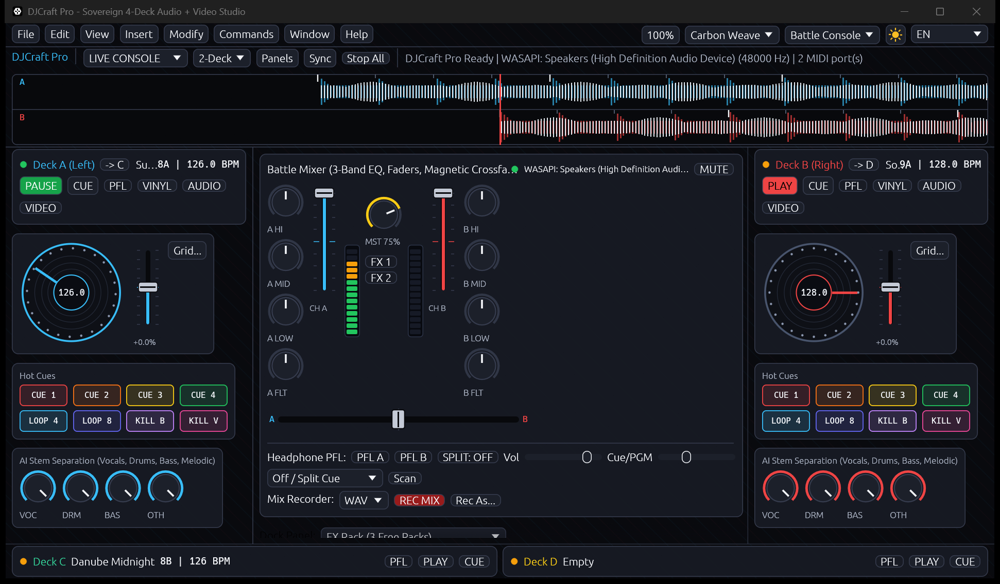
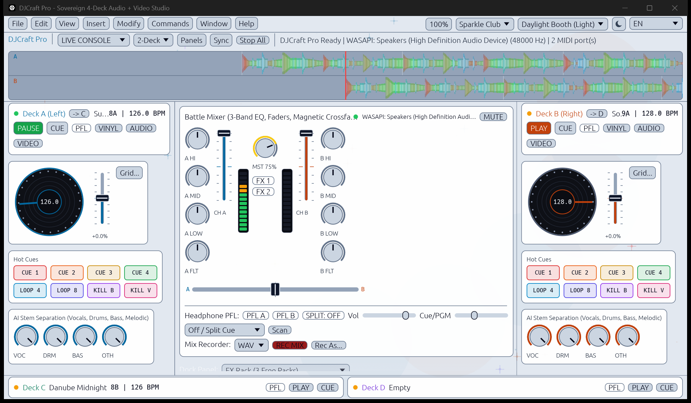
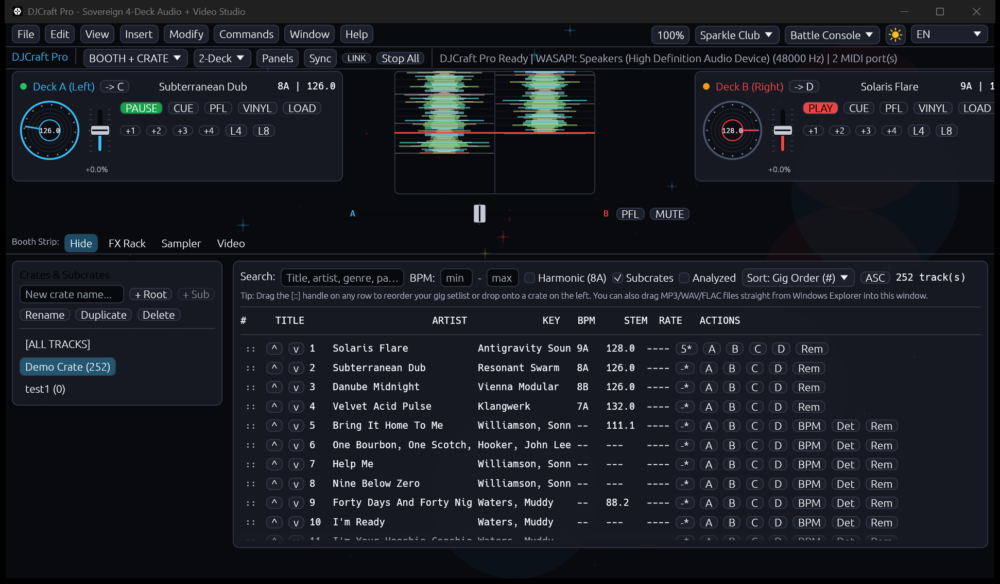
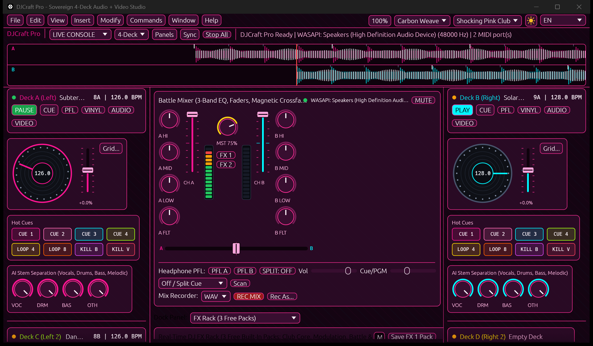
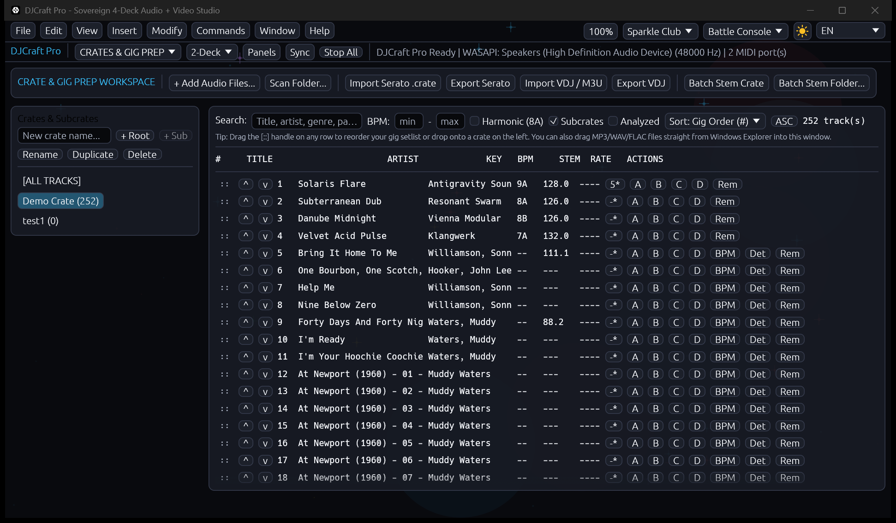

# DJCraft


**DJCraft Pro** is a local-first, 100% Safe Rust (`#![forbid(unsafe_code)]`) 4-deck audio + video DJ workstation, vinyl scratch engine, 4-stem mixer, MIDI controller host, and Camelot harmonic performance studio. GUI (`djcraft.exe`), CLI (`djcraft-cli.exe`), and MCP (`djcraft-mcp.exe`) all share one L1 `Command::dispatch` bus.

---

## Screenshots

| Live Console (Dark) | Daylight Booth (Light) |
| :---: | :---: |
|  |  |
| **Booth + Crate Split (`--booth-crate`)** | **4-Deck Mode** |
|  |  |
| **Crates & Gig Prep** | |
|  | |

Generate fresh local screenshots of all views into `docs/images/`:

```powershell
powershell -NoProfile -ExecutionPolicy Bypass -File scripts\capture-screenshots.ps1
```

---

## Install

Tell Cursor, Claude, Antigravity, or OpenCode: **Install this.**

```powershell
powershell -NoProfile -ExecutionPolicy Bypass -File scripts\install-craft.ps1
```

Or download the per-user Windows installer (`djcraft-0.2.2-setup.exe`) or Linux/macOS/Windows binaries from [GitHub Releases](https://github.com/sandraschi/djcraft/releases/tag/v0.2.2).

---

## Feature Matrix & Sub-Guides

| Area | Status | Guide |
| :--- | :--- | :--- |
| 4-Deck Audio, 3-Band RGB + Overview Waveforms, Vinyl Scratching, DVS Timecode, Auto-DJ, Quantize, Color Filter, 3-Pack FX, 4x8 Sampler, Dual-Bus/Split PFL, WAV/FLAC Rec & `.djcraft-stems/` | **Implemented** | [docs/AUDIO_AND_MIXING.md](docs/AUDIO_AND_MIXING.md) |
| Dedicated 2-Pane Crates & Gig Prep UI, `BOOTH + CRATE` Split View, Per-File Autosaved Hot Cues, Drag-Drop Ordering, Serato `.crate` & VirtualDJ Interop | **Implemented** | [docs/CRATES_AND_GIG_PREP.md](docs/CRATES_AND_GIG_PREP.md) |
| 6 Skins (incl. Shocking Pink & Daylight), Sparkle/Metal/Weave Backdrops, 2/4-Deck + Vertical Waveforms, 5-Tab Settings (`Ctrl+,`), i18n, 8 MIDI Profiles + XML Mapper Import, UDP Link & Video | **Implemented** | [docs/SKINS_MIDI_AND_VIDEO.md](docs/SKINS_MIDI_AND_VIDEO.md) |
| Side-Drawer Booth AI Chat (`Ctrl+L`), Camelot Setlists, Opt-In External Bridges, Full-Parity CLI (39 commands) & 30-Tool MCP Server (incl. Live GUI Remote Control) | **Implemented** | [docs/AI_FLEET_AND_MCP.md](docs/AI_FLEET_AND_MCP.md) |
| Standalone Release & Per-User NSIS Installer (`SHA256SUMS.txt`) | **Implemented** | [BUILD_LOG.md](BUILD_LOG.md) |

---

## Quick Verification

```powershell
# Full CI gate (fmt, clippy, 65 workspace tests, layer & asset checks)
cargo run -p xtask -- ci

# Headless smoke verification
.\target\release\djcraft.exe --smoke
```

See also: [HELP.md](HELP.md) | [CHANGELOG.md](CHANGELOG.md) | [docs/TIERED_PLAN.md](docs/TIERED_PLAN.md) | [BUILD_LOG.md](BUILD_LOG.md).

---

## Lineage - the Storytold craft-app pattern

Storytold ArtCraft ([storytold/artcraft](https://github.com/storytold/artcraft) - "the IDE for artists") was the starting point. Each craft app ships headless-first native Rust binaries sharing one L1 command bus across GUI, CLI, and MCP stdio.
